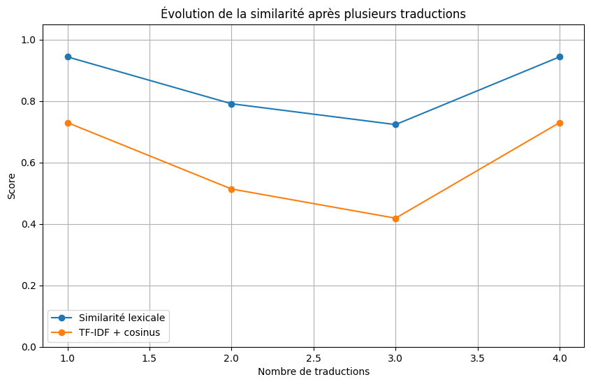

# Telephone game with NLLB

Project for the NLP course at EPITA. It's the telephone game with machine translation: an English sentence goes through a chain of languages, and at each step I translate the current text back to English and compare it with the original sentence. If the meaning drifts, the scores drop.

The translation model is [NLLB-200](https://huggingface.co/docs/transformers/model_doc/nllb) from Meta, used as is through HuggingFace Transformers, no fine-tuning. The course asked for a comparison of pretrained models, so there's also a benchmark mode that runs `facebook/nllb-200-distilled-600M` and `facebook/nllb-200-1.3B` on sentences from FLORES-200. The 3.3B can be picked in the interactive mode but I left it out of the benchmark, it's about 17 GB.

Everything is in `nlp.py`. By default the chain is French, German, Italian, Spanish. Each step translates the previous translation into the next language, then translates that back to English with the same model. So at step 4 the text has gone English -> French -> German -> Italian -> Spanish, and the Spanish version is what gets translated back. Decoding is beam search with 4 beams and at most 80 new tokens.

The back-translation is compared with the original sentence using:

- BLEU and chrF from sacrebleu (0 to 100)
- METEOR from nltk (0 to 1)
- BERTScore F1 (0 to 1)
- character similarity with difflib's SequenceMatcher, after lowercasing and removing punctuation (0 to 1)
- cosine similarity between TF-IDF vectors of words and word pairs (0 to 1)

Higher is closer to the original for all of them.

## Results

The only run in the repo is one interactive run, in `results/`. It uses the default sentence "Our NLP's teacher is the best teacher at EPITA !", the default languages and 4 steps. The csv doesn't say which model it was.

| step | language | back to English | BLEU | chrF | METEOR | BERTScore |
|---|---|---|---:|---:|---:|---:|
| 1 | French | Our NLP teacher is the best teacher in EPITA! | 46.7 | 75.7 | 0.595 | 0.972 |
| 2 | German | Our NLP professor is the best teacher in EPITA! | 32.5 | 61.1 | 0.489 | 0.967 |
| 3 | Italian | Our professor of NLP is the best teacher in EPITA! | 29.0 | 54.5 | 0.484 | 0.961 |
| 4 | Spanish | Our NLP teacher is the best teacher in EPITA! | 46.7 | 75.7 | 0.595 | 0.972 |

The meaning never really changes, only the wording (teacher or professor, "professor of NLP"). Step 4 even comes back to the exact same sentence as step 1, so the scores go back up instead of drifting further. BLEU is only 46.7 at step 1 because "NLP's" became "NLP" and "at" became "in", while BERTScore stays between 0.96 and 0.97 the whole time.



`results/bar_chart.png` shows how much the TF-IDF score drops at each step (negative for Spanish since it goes back up). The plot labels are in French.

One sentence doesn't say much. The benchmark is meant for that, but its output isn't in the repo, so there are no numbers comparing 600M and 1.3B here.

## Run

`nlp.py` reads `requirements.txt` at start to check the packages are installed, so start it from the repo root. It uses the GPU if there is one, otherwise the CPU. The first run downloads the models and the WordNet data for METEOR. The prompts are in French.

```bash
pip install -r requirements.txt
python nlp.py
```

It asks for the number of steps, prints every translation with its scores and writes `results/results.csv`, `results/bar_chart.png` and `results/line_chart.png` (so it overwrites the ones above). Options:

- `-v` prints more
- `-m` choose the model (600M, 1.3B or 3.3B)
- `-c` choose the languages from `languages.csv`
- `-r` pick the next language at random
- `-t` type your own starting sentence and its language

For the benchmark:

```bash
python download_flores.py --n 25
python nlp.py -b
```

`download_flores.py` downloads the FLORES-200 archive from Meta and writes the first n English sentences of the devtest split to `data/flores_eng.txt`. The repo already has 100 of them, so the first line is only needed if you want a different number. `-b` runs both models on every sentence with 4 steps and scores only the last step. BLEU and chrF are computed on the whole corpus, the other metrics are averaged. It prints a table and writes `results/benchmark.csv` and `results/benchmark.png`.

With the 100 sentences that's 100 x 4 x 2 x 2 = 1600 translations, plus all the metrics at every step.
